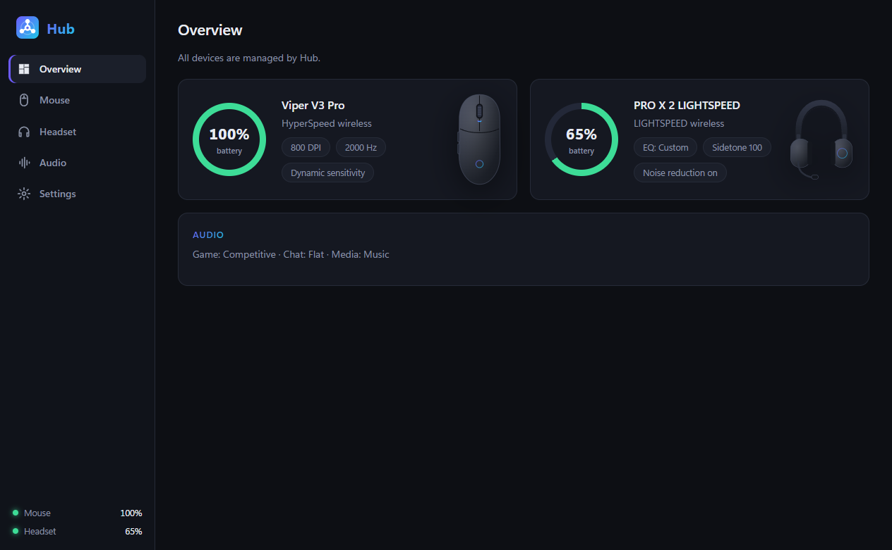
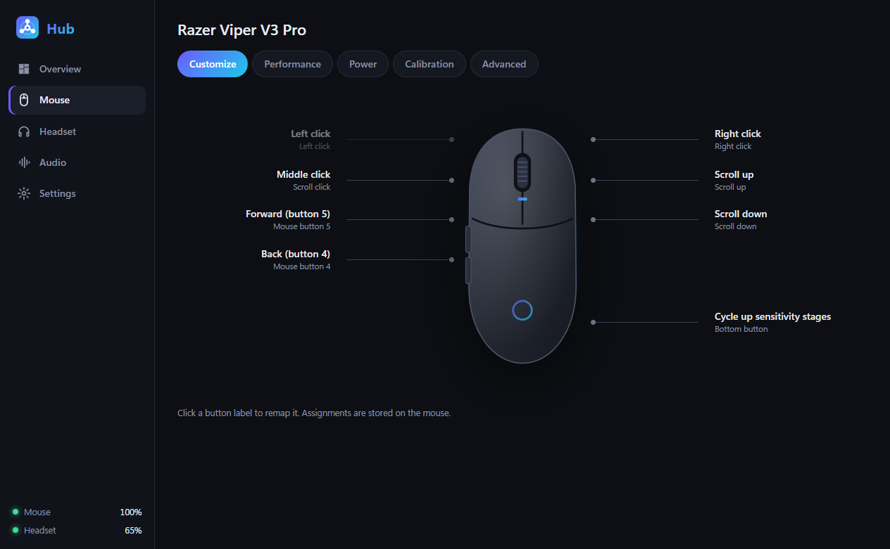
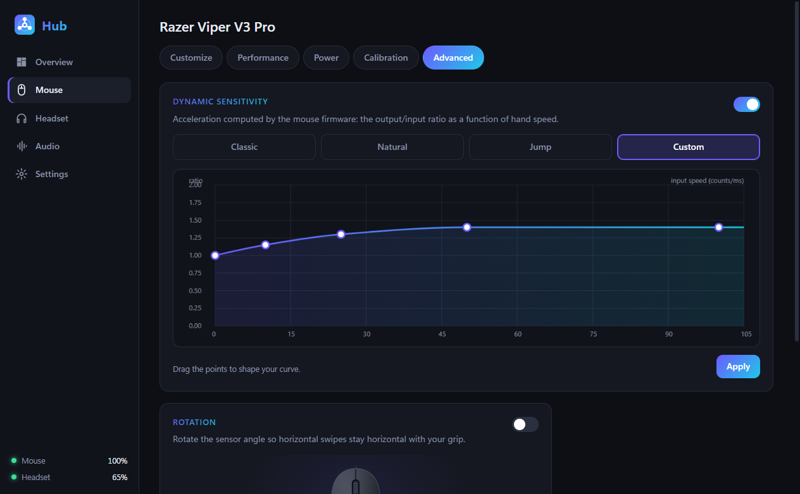
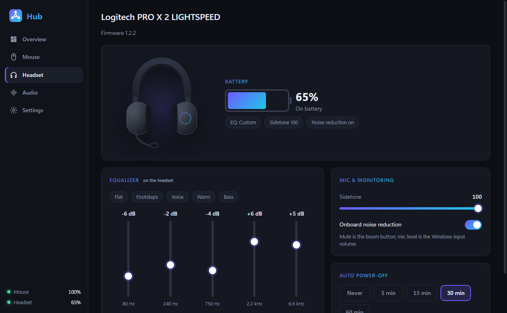
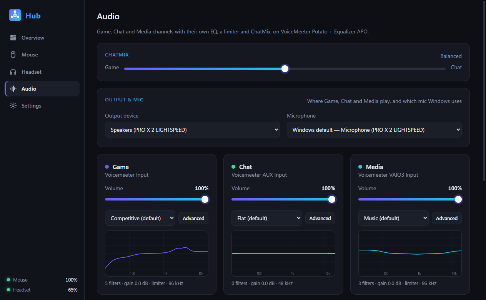
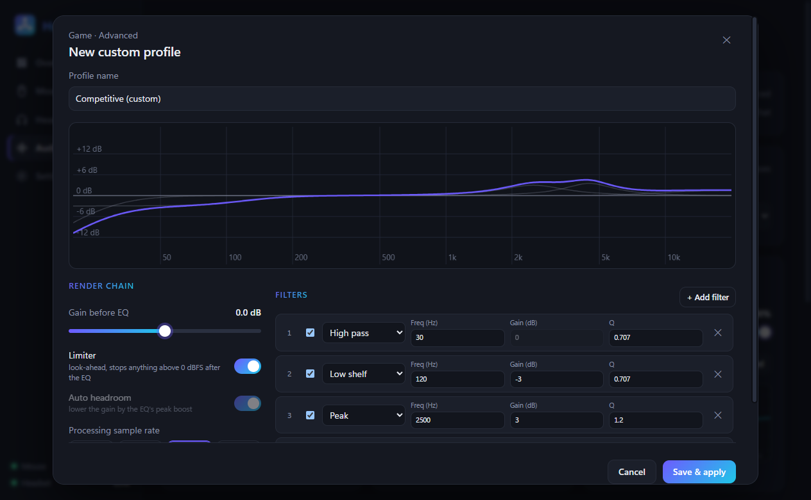
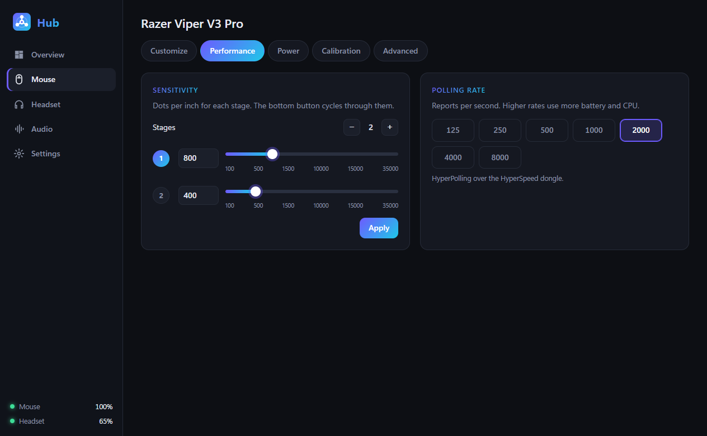

<div align="center">


# Hub

**One small tray app for your mouse, your headset and your audio channels.**
Use it instead of running three vendor suites at once.

[](https://github.com/mfaour34/hub/actions/workflows/build.yml)
[](https://github.com/mfaour34/hub/releases/latest)
[](LICENSE)


[**Download the installer**](https://github.com/mfaour34/hub/releases/latest) · [Features](#features) · [Hub vs. the vendor apps](#hub-vs-the-vendor-apps) · [Supported devices](#supported-devices) · [Build](#building-from-source)



</div>

---

## Why

A gaming mouse, a wireless headset and a good EQ usually mean three vendor apps: Razer Synapse, Logitech G HUB and SteelSeries GG/Sonar. Between them they install services, drivers, updaters and several gigabytes of files. Each starts with Windows, and each wants to own your devices.

Hub does the parts you actually use, in **one process with no services, no drivers and no account**:

- **Mouse settings** are written straight to the mouse's onboard memory, so they work even when Hub isn't running.
- **Headset EQ, sidetone, noise reduction and auto power-off** go straight to the headset, with live battery.
- **Game / Chat / Media audio channels** each get their own parametric EQ, a look-ahead limiter and a ChatMix slider.

## Features

<table>
<tr>
<td width="50%" valign="top">

### 🖱️ Mouse
- DPI stages (100–35,000) with a stage editor
- Polling rate up to 8000 Hz on HyperPolling dongles
- Lift-off: smart tracking or asymmetric cut-off
- Dynamic sensitivity: built-in modes or a custom curve you drag into shape
- Sensor rotation (±44°)
- Button remapping: mouse buttons, DPI actions, double-click, F13–F24 for macros
- Battery, sleep timer, low-power threshold

</td>
<td width="50%" valign="top">

### 🎧 Headset
- 5-band onboard EQ, tried live or saved to the headset, with presets
- Sidetone level and mic noise reduction
- Auto power-off
- Live battery with a low-battery alert (default ≤ 20 %) and a red badge on the tray icon

### 🔊 Audio channels
- **Game, Chat and Media** as separate Windows playback devices
- Up to 20 filters per channel (peak, shelf, pass, notch), shown on a live response graph
- Look-ahead limiter (0 dBFS ceiling), processing at 44.1–192 kHz
- Built-in presets are read-only. **Copy one into a custom profile** and change anything.
- ChatMix, per-channel volume, and per-app routing ("Discord → Chat")
- Pick any output device and microphone

</td>
</tr>
</table>

### Screenshots

| | |
|---|---|
|  |  |
| **Button remapping**, stored on the mouse | **Dynamic sensitivity** with a draggable curve |
|  |  |
| **Headset**: onboard EQ, sidetone, battery | **Audio channels**: EQ, limiter, ChatMix |
|  |  |
| **Advanced editor**: custom profiles from read-only presets | **DPI stages and polling rate** |

## Hub vs. the vendor apps

Measured on the same Windows 11 PC with Synapse, G HUB and GG installed side by side (October 2026, Windows 11 25H2 (build 26200) on a Ryzen 7 5700X3D). The footprint numbers come from [`tools/footprint.ps1`](tools/footprint.ps1), which is read-only, so you can run it on your own PC.

### Install footprint

| | SteelSeries GG (Sonar) | Razer Synapse | Logitech G HUB | **All three** | **Hub** |
|---|---:|---:|---:|---:|---:|
| Disk space | 1.36 GB | 1.36 GB | 2.27 GB | **≈ 5.0 GB** | **≈ 150 MB** |
| Executables | 33 | 30 | 35 | **98** | **2**¹ |
| Windows services | 1 | 2 | 2 | **5** | **0** |
| …of which start automatically | 0 | 1 | 2 | **3** | **0** |
| Vendor drivers in the driver store | 11 | 12 | 14 | **37** | **0** |
| Background updater | yes (on demand) | in-app | yes (always running) | | **none** |

¹ `Hub.exe`, plus `createdump.exe`, which comes with the bundled .NET runtime. Hub's disk figure includes that runtime, so you don't need to install .NET.

### Hub at runtime

Measured with [`tools/measure-hub.ps1`](tools/measure-hub.ps1), which launches Hub and samples it together with every child process it starts:

| | In the tray (window closed) | Window open |
|---|---:|---:|
| Processes | **1** | 7 (Hub + WebView2) |
| Private memory | **12 MB** | 224 MB |
| Working set | **52 MB** | 462 MB |
| CPU | **0.03 %** of one core | 1.2 % of one core |
| Launch to ready | 0.17 s | |

Closing the window frees WebView2 completely. Hub then goes back to one small process that polls the mouse battery once a minute and listens for headset events.

> **What's not in this table:** vendor-app RAM and CPU. Measuring them means letting all three suites take over the devices and the Windows audio defaults, so they weren't run for this comparison. `tools/footprint.ps1` and Task Manager will show you their numbers on your own PC.

### Feature parity

| What you used them for | Vendor app | Hub |
|---|---|---|
| DPI stages, polling, lift-off, rotation, button remaps | Synapse | ✅ written to the mouse's onboard memory |
| Dynamic sensitivity / custom acceleration curve | Synapse | ✅ |
| Mouse battery and sleep | Synapse | ✅ |
| Headset EQ, sidetone, noise reduction, auto power-off, battery | G HUB | ✅ written to the headset |
| Game / Chat / Media channels, parametric EQ, ChatMix | GG Sonar | ✅ Hub's own audio engine, no driver or extra software |
| Per-app channels | GG Sonar | ✅ |
| Tame loud sounds (gunshots, explosions) without losing footsteps | — | ✅ per channel |
| PC specs, live CPU/GPU load and GPU temperature (copyable) | — | ✅ System page, no driver |
| 7-day log of GPU resets, hardware (WHEA) errors, blue screens and unexpected restarts | — | ✅ System page, from Windows' own logs |
| USB devices plugged in now, and a 7-day plug/unplug timeline | — | ✅ System page |
| Mouse test: real polling rate, steadiness, switch chatter (double-click) detection | — | ✅ Mouse page |
| Aim lab: flick and tracking trainer, sensitivity finder, converter for 14 FPS games | — | ✅ own window, runs only while open |
| RGB lighting, macros recorded in-app, cloud profiles | all | ❌ not planned: F13–F24 mapping covers macros through your own tools |
| Virtual 7.1 surround (HRTF) | GG Sonar, G HUB | ❌ |

## Supported devices

Hub talks to devices through documented and community-documented HID protocols (see [`docs/protocols.md`](docs/protocols.md)). Devices not listed are detected generically. Hub checks with read-only queries which features a device supports and shows only those.

| Device | Status |
|---|---|
| Razer Viper V3 Pro (wired and HyperSpeed dongle) | ✅ verified, every feature |
| Other Razer mice | 🟡 generic: Hub detects the protocol variant and shows what the mouse answers |
| Logitech PRO X 2 LIGHTSPEED | ✅ verified, every feature |
| Other Logitech LIGHTSPEED headsets on the "Centurion" protocol | 🟡 generic: onboard EQ only if the band layout matches |
| Any headphones or speakers | ✅ audio channels work with any output device |

Adding a model is one entry in [`DeviceCatalog.cs`](src/Hub.Core/Devices/DeviceCatalog.cs). Pull requests with your device's details are welcome.

## Install

1. Download **`Hub-Setup-x.y.z.exe`** from [Releases](https://github.com/mfaour34/hub/releases/latest) and run it. It needs no admin rights and installs to `%LOCALAPPDATA%\Programs\Hub`.
2. **Quit Synapse, G HUB and GG** and turn off their autostart. Otherwise they keep overwriting device settings. Uninstall them once you're happy with Hub.
3. *(Optional, for audio channels)* Press **Turn on** on Hub's Audio page. Hub needs a second playback device to use as its silent input: Steam Streaming Speakers (installed with Steam) is ideal, and Hub shows it as **Hub (Hub Audio)** while audio is on. Leave apps' output on *Default*.

**Requirements:** Windows 10 1809+ or Windows 11 (audio channels need Windows 10 2004+) (x64), and the WebView2 Runtime, which comes with Windows 11 and current Edge. You don't need to install .NET.

**Uninstalling** points Windows back at your output device, gives the silent input device its own name back, undoes Hub 1.0's VoiceMeeter and Equalizer APO setup if there is one, and removes the autostart entry. You can choose whether to keep your settings.

## How it works

```
 ┌──────────── Hub.exe (one process, tray) ────────────┐
 │  WebView2 UI  ⇄  Bridge  ⇄  DeviceManager  ⇄  HID   │──► mouse (Razer 90-byte feature reports)
 │                         ⇄  AudioService             │──► headset (Logitech Centurion over HID)
 └──────────────────────────────┬──────────────────────┘
                                │ per-app loopback capture
  apps ─► silent sink ─► Game │ Chat │ Media ─► EQ → limiter (96 kHz) ─► mix ─► your headphones
```

- **Device settings live on the devices.** Hub only stores what the hardware can't: presets, audio choices and app preferences, in `%APPDATA%\Hub\settings.json`.
- **Audio runs in Hub, without a driver.** While Hub audio is on, Windows' default playback device is a silent "sink" (Steam Streaming Speakers, renamed *Hub (Hub Audio)*). Hub captures each app with per-process loopback, sorts it into Game, Chat or Media, runs each channel's EQ and limiter at 96 kHz and plays the mix to your output device from one real-time thread. If Hub quits, crashes or you log off, Windows goes back to playing straight to your output device.
- **The limiter** (`native/hub-limiter`, built as `hub-dsp.dll`) is a small C library: a stereo-linked look-ahead peak limiter with no runtime dependencies.

## Building from source

```powershell
# Windows, .NET 8 SDK and Zig 0.13 (for the limiter)
cd native/hub-limiter; zig cc -O2 test_limiter.c limiter.c -o test_limiter.exe; ./test_limiter.exe; bash build.sh; cd ../..
dotnet test tests/Hub.Tests
dotnet publish src/Hub.App -c Release -o publish
ISCC installer\Hub.iss            # Inno Setup 6 → dist\Hub-Setup-x.y.z.exe
```

Handy switches: `Hub.exe --selftest [log]` runs read-only device checks. `--shots <dir> [page…]` renders UI pages to PNG. `HUB_DATA_DIR` moves the settings folder. `HUB_DRY_RUN=1` stops Hub from touching Windows audio. `--audiotest [log]` prints the audio state read-only.

CI builds every push. It also installs, runs and uninstalls the installer on a clean Windows runner, then attaches the installer to tagged releases.

## License

[GPL-3.0](LICENSE). Hub is an independent project, not affiliated with Razer, Logitech, SteelSeries or VB-Audio, and ships none of their software, images or presets. See [THIRD-PARTY-NOTICES.md](THIRD-PARTY-NOTICES.md).
